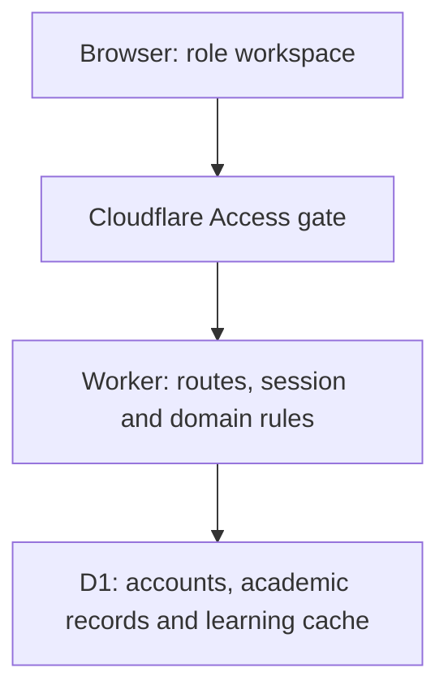

# Architecture and API reference

## Runtime topology



The UI is React/TypeScript with Next-style app routes, compiled using Vinext/Vite to Cloudflare Workers. API code imports `cloudflare:workers` bindings. The Worker verifies Cloudflare Access tokens and explicit allowed emails. Local development bypasses that outer gate only on loopback. Institution passwords/JWTs are handled by UniAdapt; no ChatGPT identity is required.

The server resolves institution sessions and validates roles/references before mutations. Teacher/Student data reads use SQL projections and response shaping for authorized records. Learning state remains in a bounded JSON cache; academic/auth records are normalized. Stale revision checks and operation-marker guards protect bulk writes; immutable Unit/calendar snapshots preserve earlier policies.

## Domain ownership

| Layer | Files | Responsibilities |
|---|---|---|
| UI | `auth-gate.tsx`, `campus-app.tsx`, `academic-setup.tsx`, `foundation-tools.tsx`, `account-controls.tsx` | Sign-in and role-specific interactive flows |
| Access/session | `private-access.ts`, `bootstrap.ts`, `auth.ts`, `access.ts`, `scoped-store.ts`, `account-admin.ts` | Private Access gateway, protected bootstrap, JWT, accounts and scope |
| Academic | `academic.ts`, `academic-store.ts`, `calendar.ts`, `student-import.ts` | Structure, assignments, allocation, versioning, timetable/exams and import |
| Learning | `engine.ts`, `grading.ts`, `store.ts`, `types.ts` | Existing objective assessment, evidence, eligibility, planning and cache |
| Persistence | `db/schema.ts`, `drizzle/*.sql` | Application schema/migrations |
| Hosting | `vite.config.ts`, `build/uniadapt-worker.ts`, `wrangler.json` | Standalone Worker build/bindings and private gateway |

No LLM calls, AI agent service, queue, vector index, production file-ingestion worker or application scheduler is configured.

## API routes

All bodies/responses are JSON except standard HTML/redirect behavior for `/`. App endpoints set no-store cache headers. Authentication uses the HttpOnly cookie, not a browser-localStorage token. The Cloudflare Access gateway protects every cloud request before these routes.

| Method / route | App authorization | Request / purpose |
|---|---|---|
| `GET /api/session` | Private gateway; institution session optional | `{user, needsSetup, ownerName, ownerEmail}`; user can be null |
| `POST /api/session` | Private gateway; setup token for bootstrap, institution auth where needed | `action: bootstrap, login, accept, logout`; identity/password/token as relevant |
| `GET /api/accounts` | Admin session | Sanitized account list; no password/token hashes |
| `POST /api/accounts` | Admin session | `action: create, update, reset, revoke, setActive` |
| `GET /api/academic` | Admin session | Academic data, Teacher list and current revision |
| `POST /api/academic` | Admin session | `{revision, action}` with academic action `type` |
| `GET /api/campus` | Institution session | Role-scoped state, revision and principal |
| `POST /api/campus` | Institution session + action/scope authorization | `{revision, action}`; course/learner/session operations |
| `GET /api/health` | Private gateway; no additional institution role check inside route | Read-only synthetic readiness probe; do not expose freely after a host migration without reviewing access |

The standalone Worker verifies the private gateway for HTML, APIs and assets. Domain routes additionally verify institution JWTs and role scope. Session entry no longer trusts native Sites headers.

## Request examples

Examples below run from the app's own browser console after an authorized sign-in, on a synthetic local/staging instance. They use cookies and same-origin calls without displaying session credentials. Do not put passwords/setup tokens into an issue or copied shell history.

Read authoritative data:

```js
const response = await fetch('/api/academic', {cache: 'no-store'});
if (!response.ok) throw new Error(`HTTP ${response.status}`);
const academic = await response.json();
console.log(academic.revision);
```

Preview a Student placement (replace IDs with returned local/staging IDs):

```js
const previewResponse = await fetch('/api/academic', {
  method: 'POST',
  headers: {'Content-Type': 'application/json'},
  body: JSON.stringify({
    revision: academic.revision,
    action: {
      type: 'previewPlacement',
      learnerId: 'LOCAL_STUDENT_RECORD_ID',
      sectionId: 'LOCAL_TARGET_SECTION_ID',
      rollNo: 'DEMO-001',
      electiveSubjectIds: []
    }
  })
});
const result = await previewResponse.json();
if (!previewResponse.ok) throw new Error(result.error);
console.log(result.preview);
```

Review first. Confirmation uses the same inputs with `type: 'confirmPlacement'` and the returned `previewHash: result.preview.hash`. Required electives must be supplied; the empty list is valid only for a target with no required choice. A changed campus revision invalidates stale previews. Use the product UI for ordinary client operations.

## Action families

`lib/academic-types.ts` is the authoritative academic union. It includes hierarchy/Institute/Subject/Offering saves, placement preview/confirm, bulk promotion/transfer and closure, combined offering activation, calendar/timetable/exams, enrollment refresh and CSV import. CSV preview uses `type: 'importStudent', csv`; confirmation adds the returned `confirmHash` from `importPreview.hash`.

`lib/types.ts` and `lib/access.ts` define the existing learning actions: draft topics/questions, Owner activation, coverage, availability, plans, practice/assigned session attempts, answers/submission/release, helper retrieval and supportive actions. Once official academic setup is established, legacy manual course/enrollment mutations are blocked; use academic authority.

## Error contract

| Status | Meaning / caller action |
|---|---|
| 400 | Invalid input/state; show domain reason and correct the form |
| 401 | Institution session missing/expired/revoked |
| 403 | Role/scope/origin/inactive authority restriction; do not retry with fabricated role/headers |
| 404 | Requested record not found where route/domain returns it |
| 409 | Stale revision/initialization conflict; reload/repreview before deliberate retry |
| 413 | Request/import/cache limit; reduce scope or resolve the storage architecture issue |
| 429 | Authentication attempt throttle; wait/review authorized policy |
| 500 / 503 | Server/storage/configuration issue; operator investigates redacted logs and readiness |

The health JSON is synthetic readiness evidence, not a complete end-user acceptance test or public API guarantee. A public stable integration API/SDK, webhook contract and API key management are not implemented.
